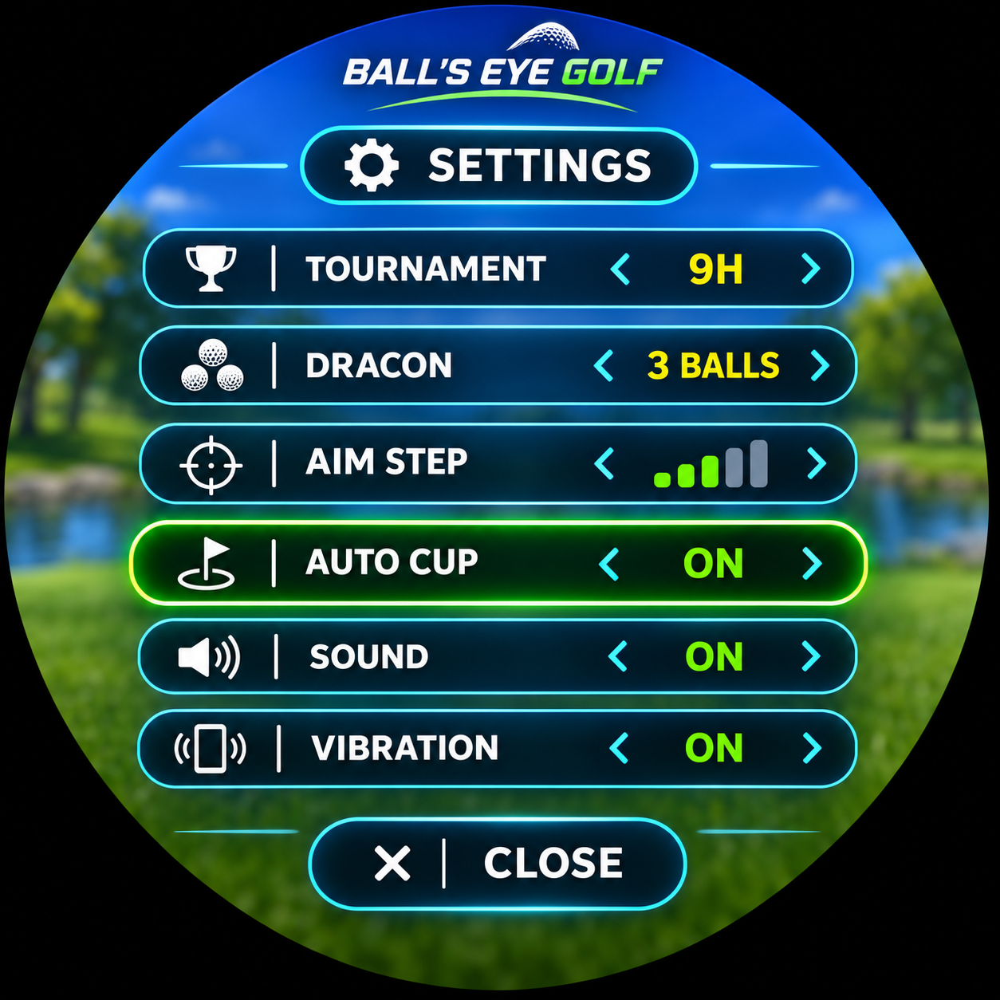
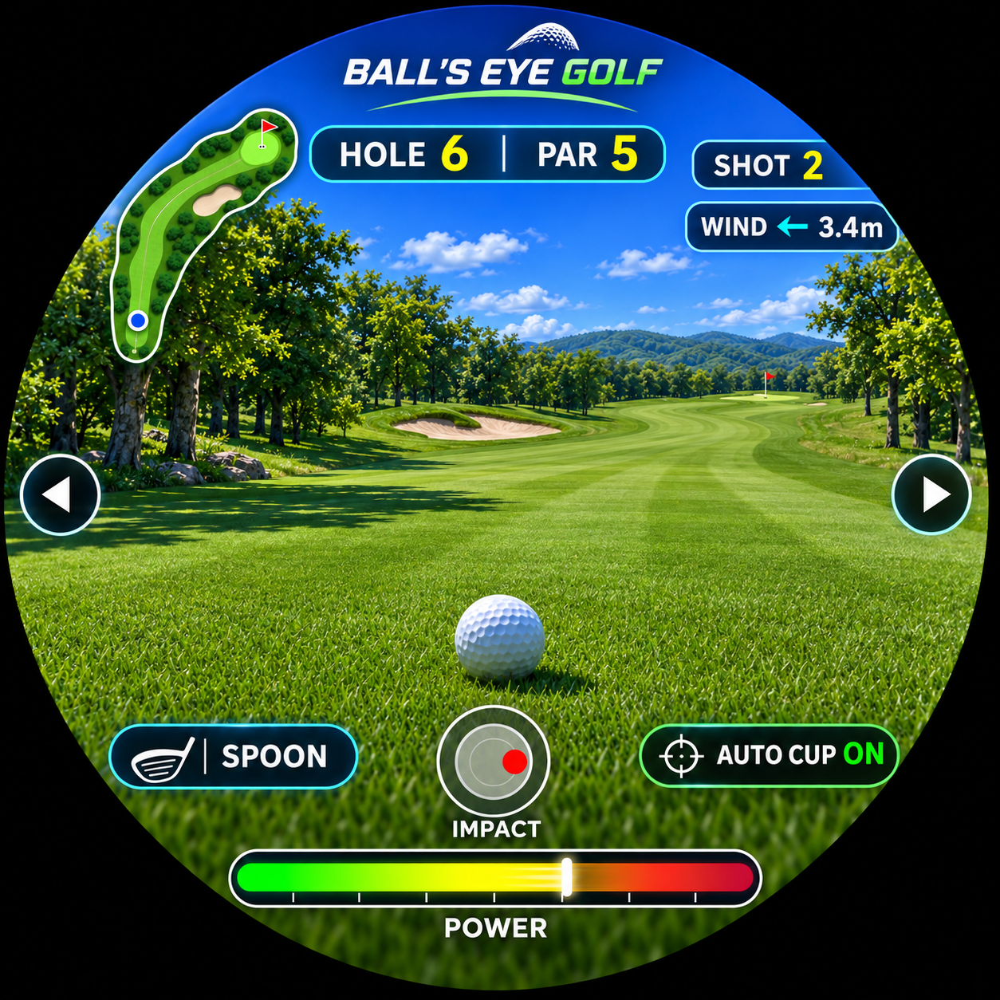

# BALL'S EYE GOLF — golfM5

M5Stack StopWatch（ESP32-S3R8 / 468×468 AMOLED）向け、一人称視点のゴルフゲーム。

  
  Image of prototype shown; final product may vary.

## Share Code
 M5bunner: K6QLhtHT8JSs3j9S

## ゲーム内容

- 9ホールのトーナメント：各ホール固有のフェアウェイ、池、バンカー、樹木、ドッグレッグなど
- 92mから480mまでのコース、9ホール終了時のスコアカード（PAR、打数、差分、通算）
- ドラコン（3球の最長飛距離）
- ボールから見た一人称視点、風・着地・転がり、IMPACTによる左右の打球カーブ
- 池や谷への落下時はボール視点の演出後、直前の打球位置へ戻り2打罰で再開
- ドライバー・スプーン・パターごとの短いPCM打球音
- カップ方向への自動旋回（AUTO CUP ON/OFF）

## 操作

| 操作 | 内容 |
|---|---|
| 右物理ボタン | ショット |
| 左物理ボタン | 設定メニューを開閉 |
| 画面左右の矢印 | 左右の照準調整 |
| IMPACT円のドラッグ | 左右の打点変更 |
| ホール終了時のTAP／左右ボタン | 次ホールへ／新ラウンド |

設定メニュー：TOURNAMENT 9H、DRACON 3 BALLS、AIM STEP、AUTO CUP、SOUND、VIBRATION。

## 謝辞・ライセンス

- [M5Stack / M5Unified](https://github.com/m5stack/M5Unified)
- [M5Stack / M5GFX](https://github.com/m5stack/M5GFX)
- [MAPLE0212 / m5stack-stopwatch-platformio](https://github.com/MAPLE0212/m5stack-stopwatch-platformio) — 起動・表示の原型となったStopWatchサンプル

元サンプルと各依存ライブラリのライセンスに従ってください。ゴルフゲーム固有コードのライセンスは別途明記します。
