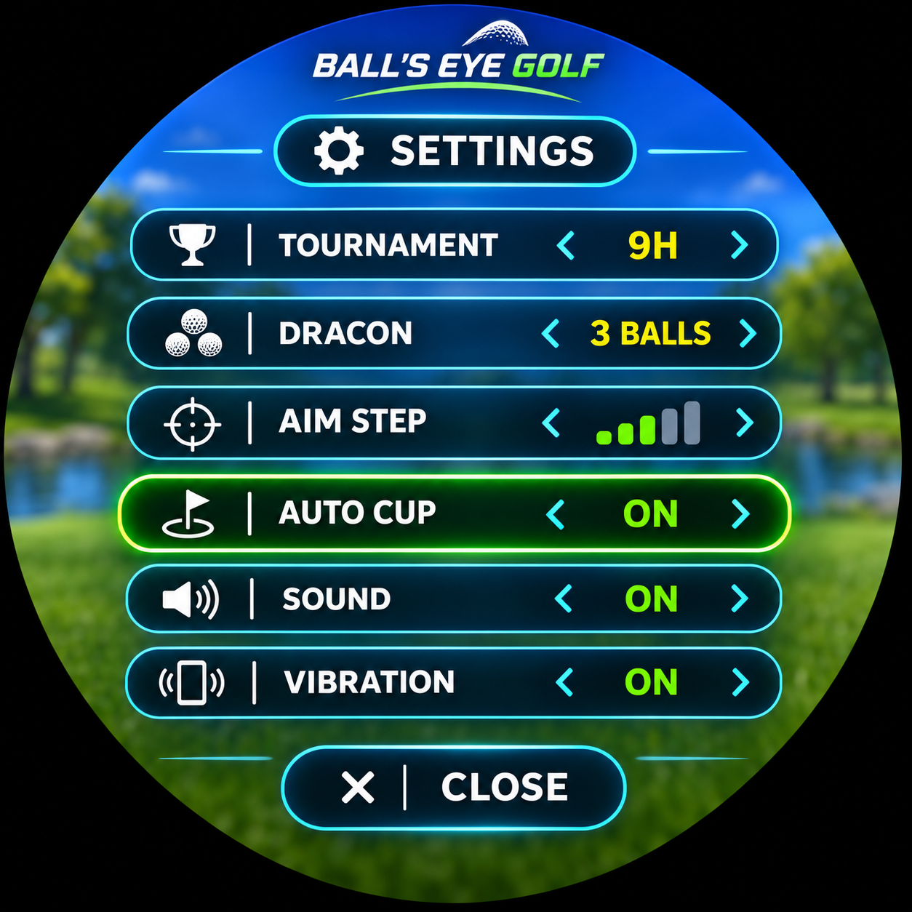
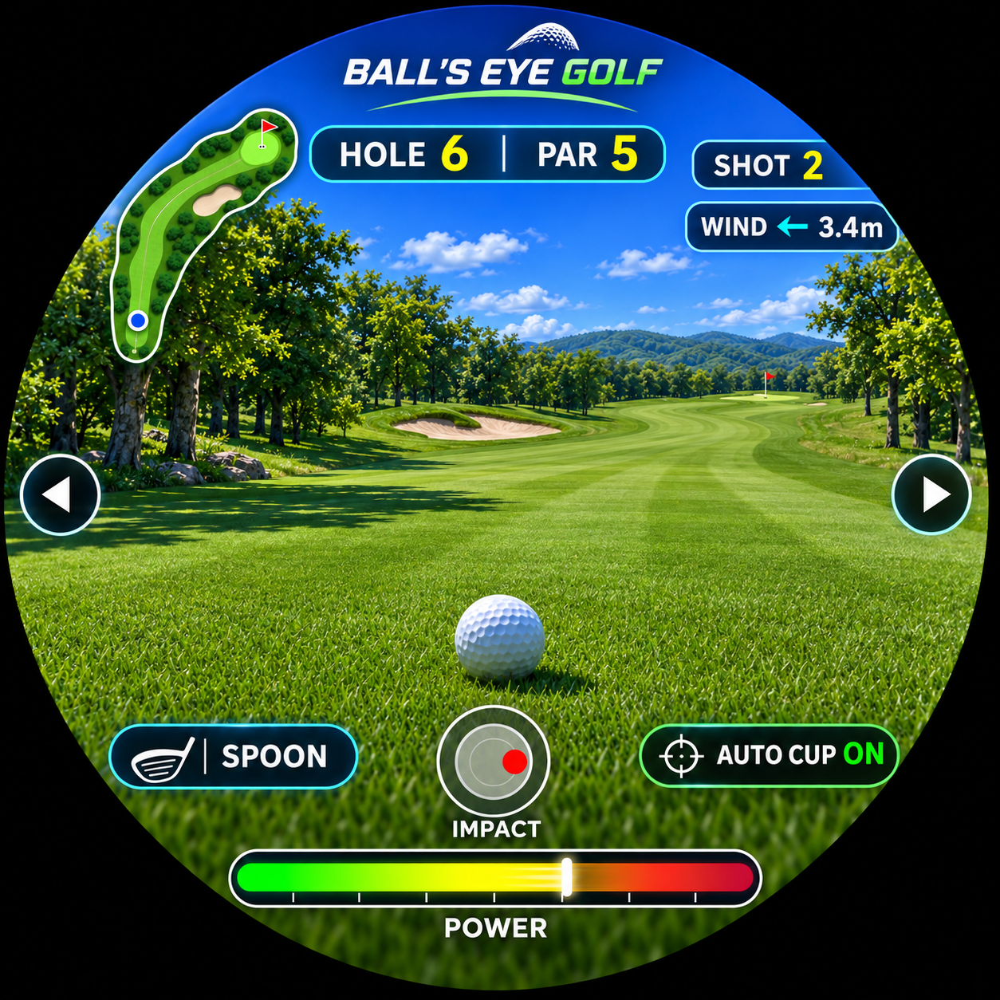

# BALL'S EYE GOLF — golfM5

[English](README.md) | [日本語](README_JA.md)

M5Stack **StopWatch**（円形AMOLED）向けの一人称視点ゴルフゲームです。**ボール自身の視点**から、飛行、着地、転がり、カップインまでを楽しめます。

 

*画像は開発中のイメージであり、実際の画面とは異なる場合があります。*

## インストール

- [M5Stack WebBurner](https://burner.m5stack.com/WQ7ULB)
- M5Burnerのシェアコード：`K6QLhtHT8JSs3j9S`

※ WebBurner掲載版と、このリポジトリの最新ソースはバージョンが異なる場合があります。

## ゲームの特徴

- **9ホール・トーナメント**：フェアウェイ、樹木、バンカー、池、谷、ドッグレッグなど、多彩なコース
- **92〜480mのコース**：PAR、打数、ホール差分、通算成績を表示するスコアカード
- **ドラコンモード**：3球の中で最長飛距離に挑戦
- 風・飛行・バウンド・転がりと、打点の左右調整による打球の曲がり
- 池や谷へ落ちたときの一人称演出とペナルティ復帰
- ドライバー・スプーン・パターそれぞれの打球音
- **AUTO CUP ON/OFF**：カップへの自動方向合わせと手動照準の切替

## 操作

| 操作 | 内容 |
| --- | --- |
| 右物理ボタン | ショット |
| 左物理ボタン | 設定メニューの開閉 |
| 画面左右の矢印 | 照準の左右調整 |
| IMPACT円のドラッグ | 左右の打点変更 |
| ホール終了後のタップ／物理ボタン | 次ホール／新ラウンド |

設定メニューには **TOURNAMENT 9H / DRACON 3 BALLS / AIM STEP / AUTO CUP / SOUND / VIBRATION** を用意しています。

## ライセンス

**BALL'S EYE GOLF の独自ソースコード**は **[MITライセンス](LICENSE)** で公開しています。Copyright (c) 2026 Layer812.

外部ライブラリ・開発ツールには、それぞれのライセンスが適用されます。リポジトリ内のスクリーンショットと音声プレビューは紹介用素材であり、別途明記がない限り**ソースコード向けMITライセンスの対象外**です。
