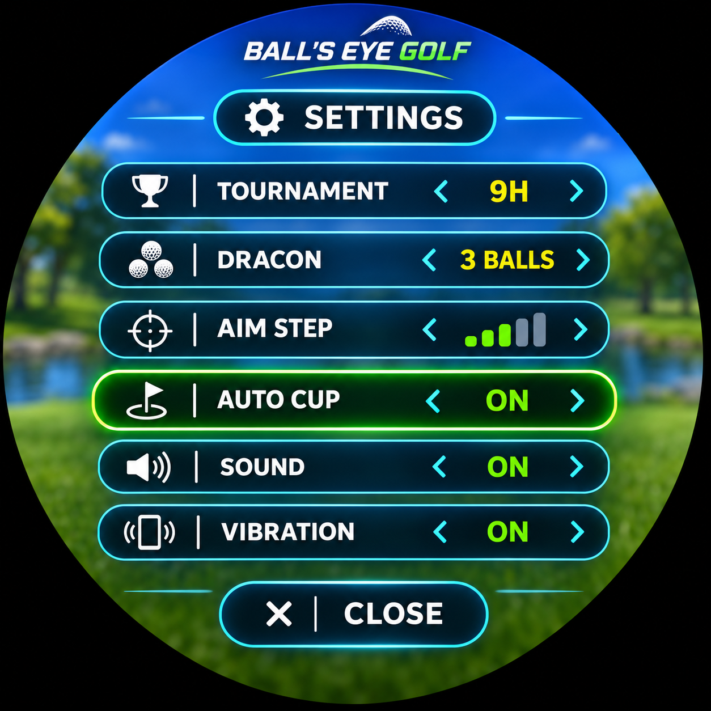
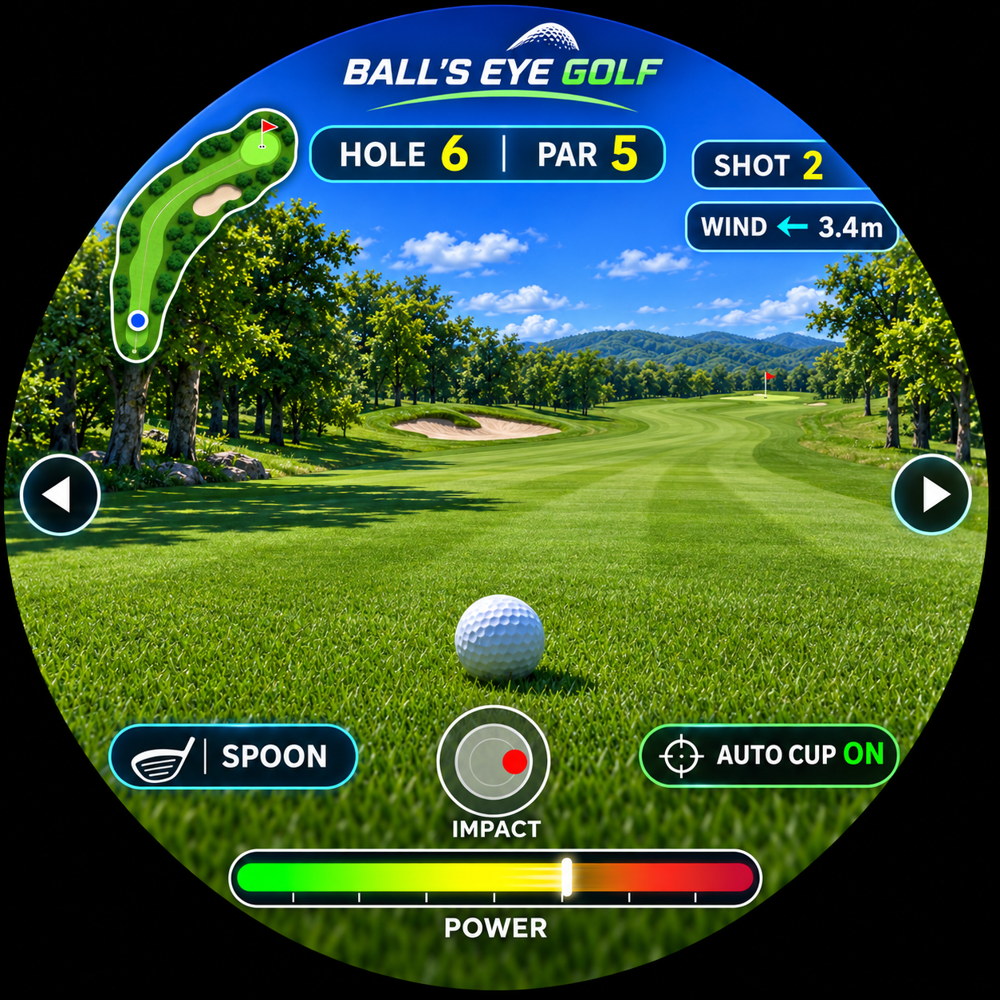

# BALL'S EYE GOLF — golfM5

[English](README.md) | [日本語](README_JA.md) | [简体中文](README_ZH.md)

专为 **M5Stack StopWatch**（圆形 AMOLED 屏幕）设计的第一人称视角高尔夫游戏。以**高尔夫球自身的第一视角**，在圆形 AMOLED 屏幕上体验每一次击球、飞行、弹跳、滚动直至进洞的全过程。

 

*游戏原型截图；最终游戏画面可能会有所不同。*

## 游戏安装与运行

- [使用 M5Stack WebBurner 安装](https://burner.m5stack.com/WQ7ULB)
- M5Burner 分享码：`K6QLhtHT8JSs3j9S`

※ WebBurner 发布的版本可能与本仓库最新的源代码版本存在差异。

## 游戏特色

- **9 洞锦标赛模式**：包含球道、树木、沙坑、水塘、峡谷和狗腿洞等丰富多样的球场环境
- **92 至 480 米球场**：配备计分卡，显示标准杆（PAR）、击球数、各洞差距以及累计总成绩
- **远击挑战赛（DRACON）**：每轮 3 球，挑战你的最远击球距离
- 高尔夫球第一视角体验，结合风力、飞行轨迹、地面弹跳、滚动以及可调节的击球点偏差
- 落入水障与峡谷的第一人称特写镜头及罚杆复位机制
- 为一号木杆（Driver）、三号木杆（Spoon）和推杆（Putter）提供定制击球音效
- **AUTO CUP ON/OFF 开关**：可自由切换自动对准球洞或全手动瞄准

## 操作说明

| 操作 | 对应动作 |
| --- | --- |
| 右侧物理按键 | 击球 |
| 左侧物理按键 | 打开 / 关闭设置菜单 |
| 屏幕左右滑动 | 调整击球瞄准方向 |
| 拖动底部 6 点方向 IMPACT 圆环 | 调整击球点左右偏差（拖动时屏幕中央实时放大预览） |
| 进洞后点击屏幕或按下物理按键 | 进入下一洞或开始新一局 |

设置菜单包含：**TOURNAMENT 9H**（9洞锦标赛）、**DRACON 3 BALLS**（3球远击赛）、**AIM STEP**（瞄准步长）、**AUTO CUP**（自动对准球洞）、**SOUND**（音效）、**VIBRATION**（震动）。

## 开源许可

**BALL'S EYE GOLF 原始源码**采用 **[MIT License](LICENSE)** 协议开源。Copyright (c) 2026 Layer812.

第三方库和开发工具遵循各自的开源协议。本仓库中的游戏截图及音频预览文件仅作为演示素材使用，除另有说明外，**不包含在针对源代码的 MIT 许可范围之内**。
